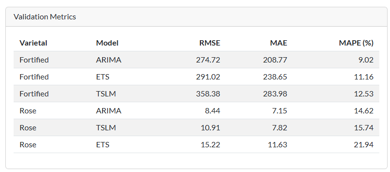
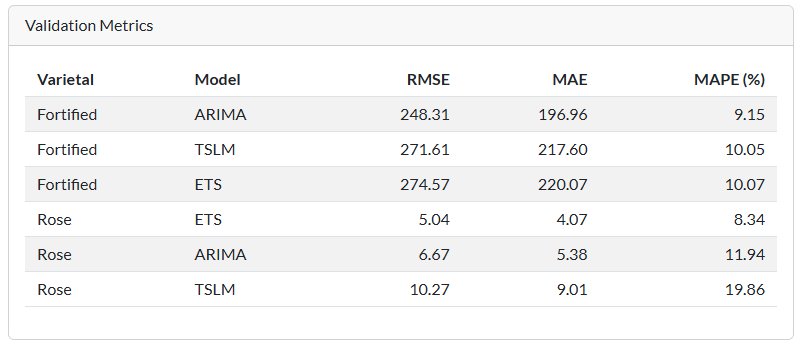

## Part I — Links and Description

- **Deployed Shiny App URL:** <https://cameronmoran23.shinyapps.io/aus-wine-forecaster/>
- **Code URL:** <https://github.com/cameronmoran23/ADS-506-ShinyApp>

**App Description:** This app acts as a tool to investigate the Australian Wine Sales dataset. It allows the user to compare and choose forecasting models by selecting one or more varietals, a date range, a training cutoff, the forecast horizon, and prediction interval level. Select these parameters in the left sidebar, then click `Fit Models` to fit the selected models for each varietal. You can then view the various tabs to check the fitted model specifications, accuracy metrics, and forecasts.

**App Features:**

- **Data:** loads `AustralianWines.csv` into a monthly tsibble keyed by varietal.
- **Controls:** select varietals, date range, training cutoff, forecast horizon, models (TSLM, ETS, ARIMA) and prediction-interval level (80% or 95%).
- **Explore Tab:** sales-over-time plots for the selected varietals, with the train/validation split marked.
- **Model Specifications Tab:** automatically selected ETS forms (e.g., ETS(M,A,M)) and ARIMA orders (e.g., ARIMA(3,0,0)(2,1,0)[12]), with key parameters and AICc.
- **Accuracy Metrics Tab:** RMSE, MAE and MAPE in separate validation and training tables, with the best model per varietal highlighted and rankable by any metric.
- **Forecasts Tab:** validation forecasts vs. actual sales and future forecasts, side by side per model, with prediction-interval bands.
- **Extra – log transform:** optionally fit models to log(Sales), which improves accuracy for some series.
- **About Tab:** data source, modeling choices and how to reproduce each figure.

## Part II — Data Story

**Insight:** Fortified and Rosé wines are two varietals that are in a decline. Annual sales for these wines fell 40% and 67% respectively between 1980 and 1994. Using a log transformation provides much more accurate forecasts for these varietals where the best model for Fortified dropped from 274.72 to 248.31 RMSE and Rosé's RMSE dropped from 8.44 to 5.04. 

**Why It Matters:** This insight matters because it indicates a clear consumer behavior trend that can be used to inform future business decisions. Wine producers and retailers can utilize this information to adjust their production and marketing strategies for these two varietals. In addition, the log transformation being able to improve forecasts for these varietals is even more useful to these groups because it allows them to more accurately forecast their production and inventory needs. This can help reduce waste and increase profitability by being able to more closely match supply with demand.

**Evidence:** 

{width=70% fig-align="center"}

{width=70% fig-align="center"}

*To reproduce both tables, use these settings in the sidebar:*
- Varietals = Fortified, Rose
- Date Range = Jan 1980–Dec 1994
- Training Ends = Dec 1992
- Models = TSLM, ETS, ARIMA
- click Fit Models -> Accuracy Metrics Tab -> Validation Metrics table
- For the second table, tick Log-Transform Data and click Fit Models again

# References

Wickham, H. (2021). *Mastering Shiny: Build interactive apps, reports, and dashboards powered by R*. O'Reilly Media. <https://mastering-shiny.org/index.html>